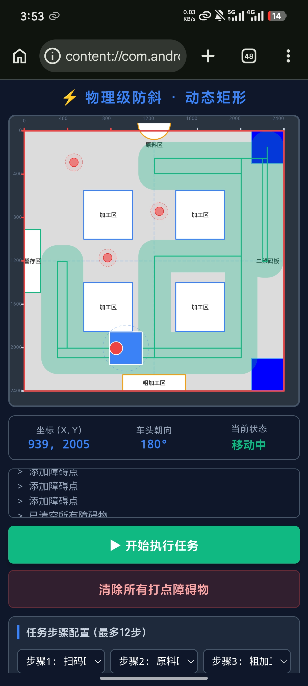

# 工创赛物流搬运车路径规划仿真（极简正交版）
> 🚩 全国大学生工程训练综合能力竞赛 物流搬运赛道 | 网页端离线仿真，纯前端实现，无需后端，打开 `index.html` 直接运行

> ## 此方案仅为测试方案，如有其他建议，请予以评价

# #（直接点击顶部about 下方的链接即可进入仿真）

## ✨ 项目简介
专为**工创赛物流搬运题目**开发的正交路径规划仿真平台，**强制只走横平竖直的直角路线，禁止斜线移动**，和真实小车运动逻辑对齐。
内置场地地图、原料区/暂存区/加工区/扫码区、双启停区、可点击添加圆形障碍物，支持自定义任务序列、车身尺寸、避障安全半径、运动速度等参数调节，用来提前验证任务流程、调试A*正交寻路、验证避障逻辑。

**核心特点**
- ✅ 纯HTML+Canvas+原生JS，无依赖，离线可用，GitHub Pages一键部署
- ✅ 正交A*寻路：只允许水平/竖直移动，自动生成L型拐点路径，自动合并冗余拐点，路线干净
- ✅ 动态障碍物：鼠标左键打点新增障碍、右键删除障碍，实时重规划
- ✅ 任务配置面板：最多支持12步任务序列，可选扫码、抓取、加工点位
- ✅ 双启停区切换（右上Z1 / 右下Z2），适配赛题两种出发位置
- ✅ 可视化状态：实时显示小车坐标、车头角度、运行状态、运行日志
- ✅ 可调参数：车身长宽、移动速度、旋转速度、抓取耗时、安全避障半径、场地区域位置
- ✅ 自带小车动画：直行、原地旋转、抓取/扫码动作动画

## 🗺️ 场地布局（2400mm × 2400mm 标准场地）
- 扫码区(QR)：`(2200, 1200)`，任务起点扫码识别任务码
- 原料区：顶部半圆形原料存放位置
- 暂存区：左侧长条暂存区域
- 粗加工区：底部矩形加工工位
- 右下加工区：右下加工工位
- 四个蓝色方形加工方块：场地固定静态障碍物
- 启停区1(Z1)：右上角出发区
- 启停区2(Z2)：右下角出发区

## 📦 使用方法
### 方式1：在线访问（GitHub Pages部署完成后）
打开你的 Pages 链接，直接在浏览器运行。

### 方式2：本地离线使用（推荐调试）
1. 下载仓库全部文件：`index.html`
2. 直接双击 `index.html`，用Chrome/Edge浏览器打开即可
> ⚠️ 不建议用IE浏览器，Canvas渲染会异常

### 🎮 操作说明
1. **启停区选择**：点击【启停区1 / 启停区2】切换小车出发位置
2. **任务配置**：下拉框依次选择任务步骤，支持最多12步任务，第一个固定为扫码区
3. **开始任务**：点击【▶ 开始执行任务】，自动全局寻路并运行仿真
4. **添加障碍物**：鼠标**左键**点击画布，放置圆形障碍物
5. **删除障碍物**：鼠标**右键**点击已有障碍物，删除该障碍
6. **清除障碍**：【清除所有打点障碍物】一键清空所有自定义障碍
7. **参数调节**：滑动滑块 / 输入数字修改车身、速度、避障半径等参数，修改后自动刷新

## ⚙️ 参数说明
| 参数 | 说明 |
| ---- | ---- |
| 车身长 L / 车身宽 W | 小车外形尺寸，用于碰撞检测，单位 mm |
| 移动速度 | 小车每帧直行移动距离 |
| 旋转速度 | 原地转向角速度 |
| 抓取时间 | 到达抓取点位后，抓取动作等待时长（s） |
| 原料区距顶 | 半圆形原料区距离场地顶部距离 |
| 暂存区中心Y | 左侧长条暂存区纵向位置 |
| 障碍物半径 | 鼠标添加障碍本体半径 |
| 避障外围半径 | 障碍物膨胀安全区，寻路时和小车保持安全距离 |

## 🧠 算法原理
- 路径搜索：**A* 网格寻路**，四邻域搜索，**禁止对角线**
- 路径平滑：寻路后自动优化，尽可能长距离直走，仅保留必要L型转弯，剔除多余拐点
- 碰撞检测：矩形小车包围盒 + 圆形障碍物碰撞判断，支持车身朝向变化的碰撞校验
- 动作队列：规划完成后生成动作队列（直行→旋转→执行抓取/扫码），按顺序动画执行

## 📸 预览截图

## ⚠️ 注意事项
1. 正交限制：本仿真**只适合工创赛直角行走方案**，若需斜向移动或者走圆弧，可自行将源码发个AI改进
2. 障碍物：蓝色方块为场地固定静态障碍，红色圆点为你手动添加的动态障碍
3. 任务顺序：扫码区必须放在第一步，仿真逻辑是先扫码再依次执行搬运任务
4. 仅仿真：本网页是方案验证仿真，不是小车下位机代码，路径点可以导出后适配ESP32/STM32小车

## 📄 许可证
MIT License，自由修改、用于竞赛备赛，欢迎二次开发
